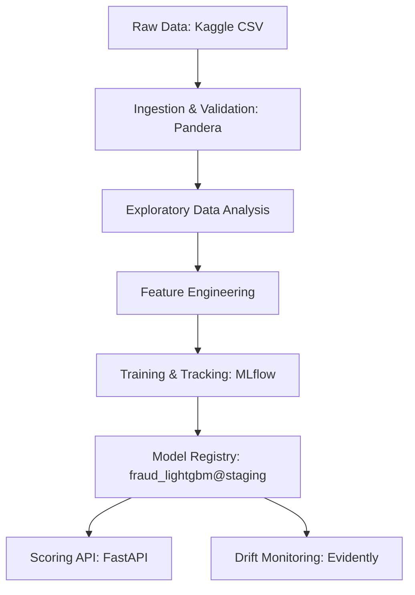

# Fraud Detection Pipeline

[](https://github.com/Josedg45/fraud-detection/actions/workflows/tests.yml)

End-to-end machine learning system for detecting fraudulent transactions: data validation contracts, feature engineering, experiment tracking, a model registry, a scoring API and drift monitoring.

## Architecture



## Key features

- **Data validation:** schema enforcement with Pandera catches data issues before training.
- **Chronological evaluation:** train on the oldest 70% of transactions, early-stop on the next 15%, report metrics on the most recent 15%, which is closer to how a fraud model is used in production than a random split.
- **Experiment tracking:** parameters, metrics (ROC-AUC, PR-AUC) and models logged to MLflow, with an input signature.
- **Model registry:** each training run registers a new version and points the `staging` alias at it.
- **Scoring API:** FastAPI endpoint that returns a fraud score and an `ALLOW` / `CHALLENGE` / `BLOCK` decision.
- **Drift monitoring:** HTML reports for data drift and prediction drift with Evidently.
- **Tests and CI:** pytest suite that runs on every push and pull request.

## Project structure

```
src/
  config.py        # tracking URI, model name/alias, model features, split sizes
  ingestion/       # load the Kaggle CSV, map it to a transaction schema, validate it
  features/        # temporal and per-user rolling features
  models/          # chronological split, baseline, LightGBM and stacking trainers, metrics
  serving/         # FastAPI app, decision rule, local prediction script
  monitoring/      # data and prediction drift reports
notebooks/         # EDA and feature design
tests/
```

## Quick start

### 1. Environment

```bash
python -m venv .venv
source .venv/bin/activate        # Windows: .\.venv\Scripts\Activate.ps1
pip install -r requirements-dev.txt
```

### 2. Data

Download `creditcard.csv` from the Kaggle [Credit Card Fraud Detection](https://www.kaggle.com/datasets/mlg-ulb/creditcardfraud) dataset and put it in `data/raw/`. The data is not versioned in this repository.

### 3. Run the pipeline

Run every command from the repository root.

```bash
# Build features -> data/processed/features.csv
python -m src.features.run_pipeline

# Train, log to MLflow and register the model as fraud_lightgbm@staging
python -m src.models.train_lgbm

# Start the scoring API
uvicorn src.serving.app:app --reload

# Drift report -> monitoring/prediction_drift.html
python -m src.monitoring.prediction_drift
```

MLflow stores runs in a local `mlflow.db` by default. Set `MLFLOW_TRACKING_URI` to use a remote tracking server.

### 4. Tests

```bash
pytest -q
```

## Features

| Used by the model | Description |
|---|---|
| `V1`–`V28` | Anonymized PCA components released with the Kaggle data; most of the signal |
| `amount` | Transaction amount |
| `hour` | Hour of day, from the Kaggle `Time` column |

The Kaggle data has no user, device or merchant fields. `load_kaggle.py` simulates them so the pipeline can show schema validation and per-user features (`txn_count_1h`, `txn_sum_24h`). Because those IDs are random, they and their aggregates are **not** model features: they would only add noise. On real transaction data they would be added to `FEATURES` in `src/config.py`.

## API usage

`POST /predict` takes the model features, plus an optional `transaction_id` that is echoed back.

```json
{
  "transaction_id": "999",
  "amount": 80.0,
  "hour": 14,
  "V1": -1.36, "V2": -0.07, "V3": 2.54,
  "...": "V4 to V28 are required as well"
}
```

Response:

```json
{ "transaction_id": "999", "fraud_score": 0.003, "decision": "ALLOW" }
```

The decision is `BLOCK` from a score of 0.2, `CHALLENGE` from 0.14 and `ALLOW` below that (`src/serving/decision.py`).

## Results

Run `python -m src.models.train_lgbm` to get the test ROC-AUC and PR-AUC on the most recent 15% of transactions. Both are logged to MLflow (`mlflow ui --backend-store-uri sqlite:///mlflow.db`).

The Kaggle dataset is highly imbalanced (about 0.17% fraud), so PR-AUC is the more informative metric: a random model scores about 0.0017.
